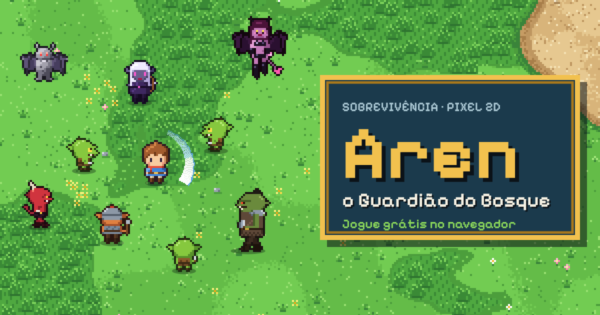

# Aren, o Guardião do Bosque

### ▶ [Jogar agora no navegador](https://narley1.github.io/aren/)

Aren, aprendiz de guardião, só tem a velha espada da família quando o enxame invade o bosque. Sobreviva às hordas por 15 minutos, recolha os poderes que as criaturas deixam cair e derrote os três chefes: o Paladino Possuído aos 5 minutos, o Lich Ancião aos 10 e o Dragão Esqueleto aos 15.

## Como jogar

- **Computador:** WASD ou setas para andar · **P** pausa · **F** tela cheia
- **Celular:** toque e arraste em qualquer lugar da tela
- As armas atacam sozinhas; você só se movimenta.

## O que tem no jogo

- Inimigos: goblins, gárgulas, hobgoblins, elfos negros, orcs, demônios, súcubos e wyverns; o Lich ainda invoca esqueletos
- Três chefes com ataques avisados no chão, duas fases e música própria; enquanto o Paladino ou o Lich vive, o relógio da partida para
- Joias viram experiência; nos níveis de escolha você pega um entre três poderes, cada um com estilo Corpo a corpo, A distância ou Híbrido: Espada, Martelo Sísmico, Aura de Espinhos, Shuriken Gigante, Arco Élfico, Fogo-fátuo, Magia de Fogo e os passivos Botas Ligeiras, Amuleto Ímã, Recipiente de Coração, Manoplas do Guerreiro e Grimório Arcano
- Relíquias que só os chefes soltam: Espada Sagrada (Paladino) e Cajado da Tempestade (Lich)
- No chão caem meios corações para curar e, raramente, cristais que aprimoram um poder que você já tem
- Pixel art no estilo 32 bits, música que muda com o momento do jogo (ocarina, flauta e alaúde) e efeitos sonoros sintetizados

## Instalar como app

Abra o link no celular. No Android (Chrome), toque em **Instalar app**; no iPhone (Safari), use **Compartilhar → Adicionar à Tela de Início**. Instalado, o jogo abre em tela cheia e funciona sem internet.

## Detalhes técnicos

Tudo roda num único `index.html` em HTML5 Canvas e JavaScript puro, sem bibliotecas: os sprites são desenhados em código, o áudio é gerado com a Web Audio API e a fonte vai embutida. O `manifest.webmanifest` e o `sw.js` deixam o jogo instalável e jogável offline.

Fonte: [Pixelify Sans](https://github.com/eifetx/Pixelify-Sans), licença SIL Open Font License 1.1 (veja `OFL.txt`).
