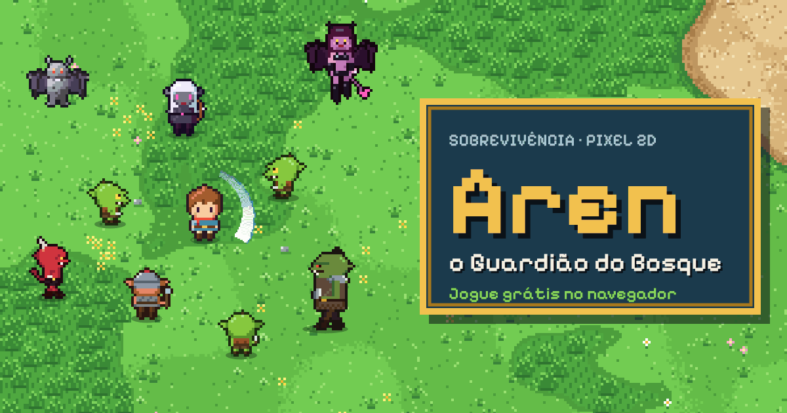

# Aren, o Guardião do Bosque

### ▶ [Jogar agora no navegador](https://narley1.github.io/aren/)

Aren, aprendiz de guardião, só tem a velha espada da família quando o enxame invade o bosque. Sobreviva às hordas, recolha os poderes que as criaturas deixam cair e enfrente o Dragão Esqueleto aos 10 minutos.

## Como jogar

- **Computador:** WASD ou setas para andar · **P** pausa · **F** tela cheia
- **Celular:** toque e arraste em qualquer lugar da tela
- A espada ataca sozinha quando há inimigos por perto.

## O que tem no jogo

- 9 tipos de inimigo: goblins, gárgulas, hobgoblins, elfos negros, orcs, demônios, succubus, wyverns e o Dragão Esqueleto
- Poderes que caem dos inimigos: evolução da espada, bumerangue, Will-o'-Wisp, cajado de fogo, botas, amuleto ímã, corações e maçãs
- Relíquias lendárias depois dos 5 minutos: Espada Sagrada, Cajado da Tempestade e Chuva de Meteoros
- Chefe final com padrões de ataque próprios e a mecânica dos Selos de Luz
- Pixel art no estilo 32 bits, música que muda com o momento do jogo (ocarina, flauta e alaúde) e efeitos sonoros sintetizados

## Instalar como app

Abra o link no celular. No Android (Chrome), toque em **Instalar app**; no iPhone (Safari), use **Compartilhar → Adicionar à Tela de Início**. Instalado, o jogo abre em tela cheia e funciona sem internet.

## Detalhes técnicos

Tudo roda num único `index.html` em HTML5 Canvas e JavaScript puro, sem bibliotecas: os sprites são desenhados em código, o áudio é gerado com a Web Audio API e a fonte vai embutida. O `manifest.webmanifest` e o `sw.js` deixam o jogo instalável e jogável offline.

Fonte: [Pixelify Sans](https://github.com/eifetx/Pixelify-Sans), licença SIL Open Font License 1.1 (veja `OFL.txt`).
